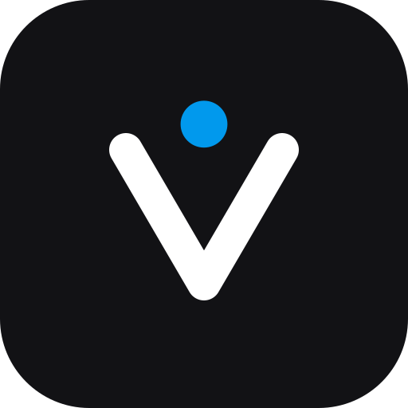
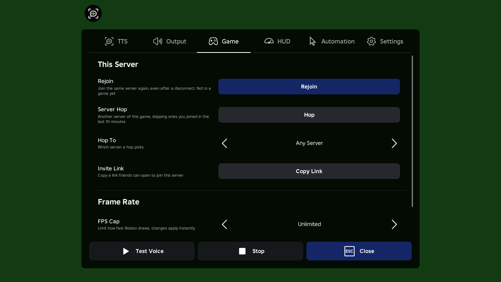
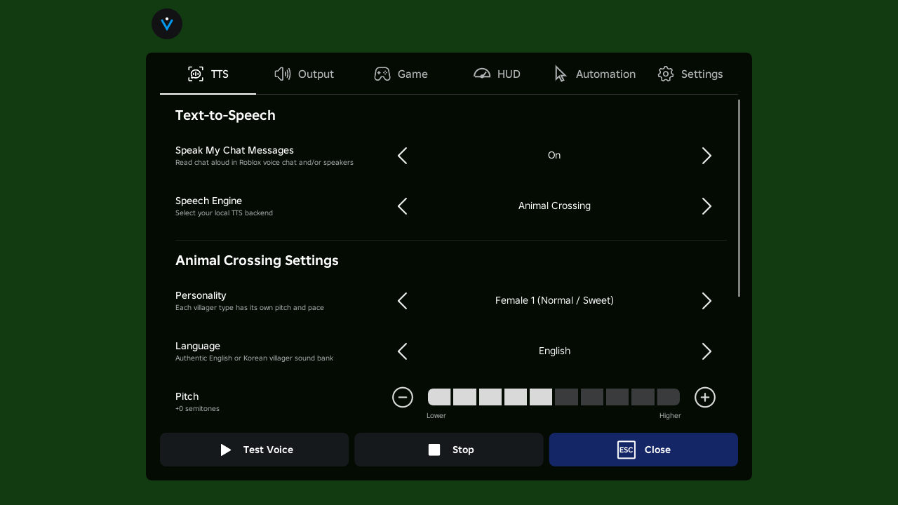
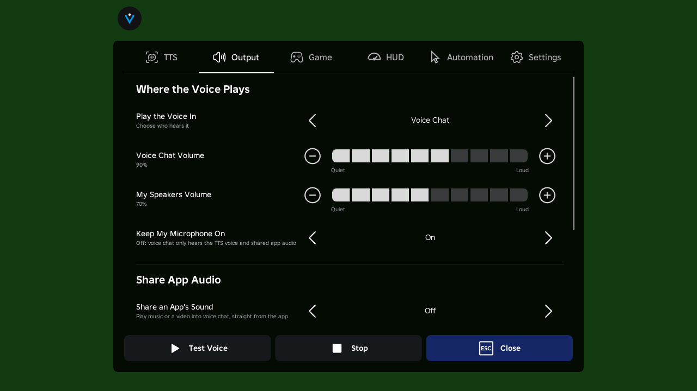
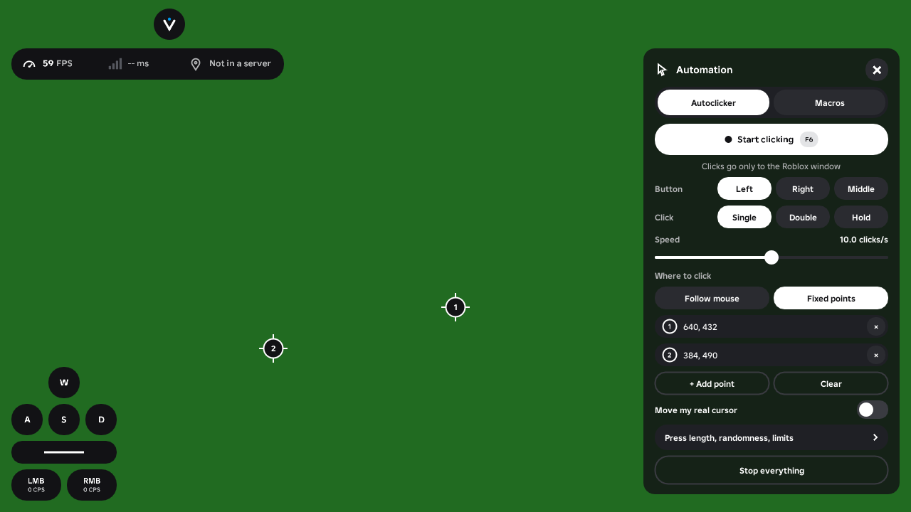

<p align="center">
  
</p>

<h1 align="center">Vox Menu</h1>

An in-game menu for Roblox on Linux through [Nightcap](https://github.com/CoderDayton/nightcap): local
text-to-speech into voice chat, movable HUD overlays (FPS, ping, server location, keystrokes),
an autoclicker and macros, a MIDI piano player, and rejoin / server hop / FPS cap controls. Styled like
Roblox's own menu.

Vox Menu (formerly Vox TTS and Nightcap AC) is one library, `libvox_menu.so`, loaded into an
unmodified Nightcap. It needs no virtual audio cables, virtual microphone or separate app.

<p align="center">
  
</p>

## Features

* **Text-to-speech in voice chat:** every chat message you send is spoken into Roblox voice chat
  with a local engine: Piper (neural), eSpeak-NG, or Animal Crossing's Animalese. You can hear it
  on your speakers too, or speak through TTS without sending the text at all (Intercept Chat).
* **Share an app's sound in voice chat:** play music or a video from any app (Spotify, a browser,
  mpv...) into the mic, mixed with your voice or instead of it. Recorded straight from that app's
  stream: no virtual cables or devices, and Roblox's own audio is never sent back.
* **HUD overlays:** FPS (with frame time), ping, server location and a keystrokes display
  (W A S D, Space, mouse buttons with clicks per second). Drag them anywhere and resize them in the
  layout editor, with snapping to the screen edges, its centre and each other. They look like
  Roblox's own top-bar buttons (44 px pills, its colors). Drop one right beside another and they
  join into one pill, like its menu / chat / mic group, and stay joined as the numbers change.
* **Autoclicker:** a floating window that stays on screen while you play. Click where the mouse is
  or at fixed points you place on the screen (clicked in turn), left/right/middle, single/double/hold,
  1 to 100 clicks per second, random timing and position, a click or time limit, and a start delay.
  Clicks go only to the Roblox window, and can leave your real cursor where it is.
* **Macros:** record your keys, clicks, typed text and (optionally) mouse movement, edit the steps,
  and play them back once, a number of times or on a loop, at any speed. Saved as plain-text files.
* **Piano player:** plays `.mid` files on Roblox's virtual pianos (ported from MIDI++): the
  61-key layout or all 88 keys, transpose, fitting out-of-range notes, sustain pedal, loudness keys,
  human timing, speed, track mute / solo with drum tracks muted. It can also play a MIDI keyboard
  into the game, as piano keys or MIDI Connect codes. Keys go only to the Roblox window, and a
  StreamController plugin can drive it.
* **Rejoin and server hop:** rejoin the last server (even after a disconnect), hop to another
  server of the same game (any, the emptiest, or the best ping), or copy an invite link to the
  server you're in. Nightcap leaves and joins in place; nothing restarts.
* **FPS cap:** cap the frame rate at any number, with a separate (lower) cap while Roblox isn't
  focused. Changes apply instantly.

* **In VR:** the menu opens as a panel in front of you (hold the left thumbstick click), and the
  FPS / ping / server stats can sit low in your view. Everything but keystrokes and automation
  works from the headset.

All of it is in the in-game menu: press **F8** or click the top-bar button.

## Requirements

* Nightcap on Linux, native install (`mocktail` on your PATH). Flatpak is best-effort.
* Nightcap's Vulkan renderer (the default), not OpenGL.
* For TTS: `espeak-ng` (most distributions have it) and optionally `piper` for neural voices.
* For server hop: `curl` (or Python 3) to read Roblox's server list.
* For a MIDI keyboard: ALSA's `libasound` (almost always installed).
* For sharing app audio: `pactl` and `parec` (`libpulse` / `pulseaudio-utils`), with PulseAudio or
  PipeWire's PulseAudio layer (`pipewire-pulse`).
* To build: a C++17 compiler, SDL3, Vulkan and OpenXR headers (`sdl3`, `vulkan-headers`, `openxr`
  on Arch/Artix).

## Install

```bash
git clone https://github.com/dim-ghub/vox-tts
cd vox-tts
make build
make install          # into ~/.local (PREFIX=... to change)
```

`make install` installs the `vox-menu` launcher and `libvox_menu.so`, the
`vox-menu-download-voice` helper, a desktop entry, and the Vulkan layer manifest. The old
`vox-tts` and `nightcap-ac` commands keep working as aliases.

It then asks:
```
Patch it? [y/N]
```
Answering **y** updates Nightcap's launcher entry so normal launches and `roblox://` links
(joining games from the website) start Nightcap with Vox Menu. A launcher patched by Vox TTS or
Nightcap AC is updated without asking.

To undo:
```bash
make unpatch-desktop    # restore the previous launcher entry
make uninstall          # remove everything installed
```

## Downloading Neural Piper Voices

Vox Menu includes a helper script to download Piper neural voice models directly from Hugging Face into `~/.local/share/piper-voices`:

```bash
# Download default voice (en_US-lessac-medium)
vox-menu-download-voice

# Or download other voices:
vox-menu-download-voice en_US-amy-medium
vox-menu-download-voice en_US-ryan-medium
```

Any `.onnx` models placed in `~/.local/share/piper-voices` (or configured via a custom directory in Settings) appear in the in-game model picker.

## In-Game Menu

Press **F8** or click the top-bar button to open the menu.

| Key | Action |
| --- | --- |
| Tab / Shift+Tab, ↑ / ↓ | Select the next / previous option |
| ← / → | Change the selected option |
| Enter / Space | Toggle or activate |
| Q / E | Previous / next tab |
| Esc or F8 | Close the menu |

### Tabs

1. **TTS (Text-to-Speech):**
   * **Speak My Chat Messages:** Master toggle for speaking chat.
   * **Speech Engine:** Choose between `Piper (Neural)`, `eSpeak-NG`, or `Animal Crossing`.
   * **Active Engine Settings:** Each engine only displays its own controls when active:
     * *Piper*: Voice model picker, custom model file path, speed multiplier, binary status.
     * *eSpeak-NG*: Voice/accent picker, speed (WPM), pitch slider.
     * *Animal Crossing*: Villager personality (F1–F4, M1–M4), language (English/Korean), pitch, speed, and letter samples pack.
   * **Test Voice & Stop Controls:** Immediate auditioning and audio playback controls.

<p align="center">
  
</p>

2. **Output:**
   * **Share App Audio:** turn on **Share an App's Sound**, pick the **App** (any app playing sound,
     or *All Other Apps*), and set its **Volume**. It is sent while you're unmuted in voice chat;
     **Keep My Microphone On** off sends only the app (and TTS), not your voice. Use headphones,
     or your mic will pick the app up from your speakers too.
   * **Play Voice In:** Voice Chat, Voice Chat + Me, or Only Me.
   * **Voice Chat / Local Volume:** Independent sliders.
   * **Keep Microphone On:** Allow speaking through real mic alongside synthetic speech.
   * **Voice Chat Status:** Live indicator showing if Roblox is currently capturing audio.

<p align="center">
  
</p>

3. **Game:**
   * **Rejoin:** join the last server again, also after a disconnect or a kick.
   * **Server Hop:** another server of the same game. Servers you joined in the last
     10 minutes are skipped. **Hop To** picks any server, the one with the fewest players, or
     the one with the best ping.
   * **Invite Link:** copies a `roblox.com` link friends can open to join your server.
   * **FPS Cap** (presets, or type any number into **Exact FPS Cap**), and a separate cap
     **When Roblox Isn't Focused**.

4. **HUD:**
   * Turn on the **FPS Counter** (optionally with frame time), **Ping**, **Server Location**
     (optionally with the address) and **Keystrokes** (Space bar, mouse buttons and clicks per
     second optional).
   * **Edit Layout** hides the menu and lets you drag the overlays anywhere. Drag the corner
     handle or scroll to resize, right-click to hide one, and hold Shift to move without snapping.
     Drag an overlay up beside another: near it, it locks into place and the two show as one
     blue-outlined pill; drop it there to join them. Drag it out again to separate them. Esc or Done goes back to the menu.
   * **Match Roblox's Look** (on by default): overlays are solid like Roblox's top-bar buttons,
     and the automation window is as see-through as Roblox's menu (following its *Background
     Transparency* setting). Turn it off to set your own **Background** opacity. Also
     **Pressed Keys** (white or blue), **Snapping** and **Reset Positions**.

<p align="center">
  
</p>

5. **Automation:**
   * **Automation Window:** shows the floating autoclicker and macros window (below).
   * **Pause While This Menu Is Open:** no clicks or macro keys reach the game behind the menu.
   * **Hotkeys:** autoclicker on/off (**F6**), play/stop macro (**F7**), record macro (**F9**),
     show / hide the automation window (**F4**).
     Each can be F1 to F12 (except F8), Insert, Home, End, Page Up/Down, Pause, a mouse side
     button, or none.
   * **Piano:** opens the Piano tab, its hotkeys (play / pause **F1**, back 10 s **F2**, forward
     10 s **F3**) and the **Songs Folder** (your Music folder unless set).

6. **Settings:**
   * **Intercept Chat:** speak messages through TTS instead of sending them to Roblox's chat.
   * **Skip Chat Commands:** don't speak messages starting with `/` (e.g. `/e dance`).
   * **Menu Button:** top left, top right, or hidden.
   * **Custom Voices Folder:** another directory to scan for Piper `.onnx` models.

### In VR

When Nightcap shows the game in a headset, Vox Menu is there too, without going back to the desktop:

* **Open the menu:** hold the **left thumbstick click** for half a second (or the right one; see
  *Open in VR* in Settings). The panel opens in front of you, facing you; hold the click again or
  press **Close** to put it away.
* **Use it:** point a controller at the panel (a blue dot shows where) and pull the **trigger** to
  click; push the thumbstick up or down to scroll. While it is open, the game doesn't get your
  buttons or sticks, like the desktop menu keeps the mouse and keyboard.
* **What's there:** the TTS, Output, Game, HUD and Settings tabs. Text fields show their value but
  are edited on the desktop (there's no keyboard in the panel); Test Voice plays the saved test
  message. The autoclicker, macros, keystrokes and the layout editor are desktop-only.
* **Stats in view:** the FPS, ping and server overlays you have on show as one pill low on the left
  of your view (HUD tab, *Show These Stats*). FPS counts the headset's frames.
* **The FPS cap is off in VR,** so it can never hold the headset back.

This needs Nightcap's Vulkan graphics (`direct-vulkan`, its default); with OpenGL the game still
runs, without the panel.

### The Automation Window

A window of its own that stays on screen while the menu is closed, so you can start and stop
things while playing. It takes the mouse only where it is drawn (and only while your cursor is
free, not in first-person mouse lock); everywhere else your clicks reach the game as usual. Drag
it by its title bar; it snaps to the screen edges.

**Autoclicker tab**

* **Start / Stop** (or the hotkey). A badge at the top of the screen shows it's running.
* **Button**, **Click Type** (single, double, hold down), **Speed** and **Press Length**.
* **Where to Click:** *Follow Mouse*, or *Fixed Points*: **+ Add Point**, then click where it
  should go. Points show on screen as numbered markers you can drag, or right-click to remove.
  **Move Real Cursor** moves your cursor to each point; off, the game is sent the click at the point
  and your cursor stays where it is.
* **Randomize, Limits and Delay:** timing jitter, position spread, stop after a time or a number
  of clicks, and a countdown before starting.

**Macros tab**

* **Record** (or **F9**), play in the game, then stop. Your keys, clicks and typed text are
  recorded with their timing, and mouse movement too when **Record Mouse Movement** is on.
* **Play** (or **F7**) with a **Repeat** count (0 loops until stopped) and a **Speed**.
* Edit the steps: select one to change it (key, mouse button and point, wait time, text), move it
  up or down, delete it, or add key presses, clicks, waits and text.
* **Save** under a name, and load or delete saved macros. They're plain text in
  `~/.config/vox-menu/macros/`, one step per line (`key_down W`, `wait 120`,
  `click left 0.5 0.5`, `text gg`), so you can write them by hand too.

**Piano tab**

* **Play / Pause** (or **F1**), a progress bar to drag through the song, **-10 s**, **Restart**,
  **+10 s** and **Speed** (0.25x to 2x).
* **Songs:** every `.mid` / `.midi` file in the songs folder and its sub-folders, with a search
  box. Click one to play it.
* **Tracks:** mute or solo each; drum tracks start muted.
* **Keys and Timing:** **All 88 Keys** (Ctrl + key past the middle 61, as Virtual Piano does),
  **Fit Notes Into Range**, **Transpose**, **Sustain** (Space held with the pedal, or inverted),
  **Loudness Keys** (Alt + key before notes) and **Human Timing**.
* **MIDI Keyboard:** play a keyboard plugged into the computer into the game, as piano keys or as
  MIDI Connect numpad codes for games that read those. Every keyboard found is used, ones plugged
  in later too (ALSA sequencer).

Black keys are Shift + the white key below, the way Roblox pianos expect, with Shift (or Ctrl)
held only around that key.

**Stop Everything** stops the autoclicker, recording, macro and song playback, and releases any
key or button they were holding.

### StreamController

The piano listens on `~/.vox-menu-piano.sock`, one command per connection, the same protocol as
MIDI++'s: `PLAY_PAUSE`, `REWIND`, `SKIP`, `RESTART`, `STOP`, `SPEED_UP`, `SPEED_DOWN`,
`GET_TIME` (JSON with `current`, `total`, `speed`, `paused` and `song`), `LIST_SONGS` (a JSON array
of names) and `LOAD_SONG <index>`. The
[MIDI++ StreamController plugin](https://github.com/dim-ghub/MidiPlusPlus-SD) drives it.

## How It Connects to Nightcap

Vox Menu runs inside Nightcap and uses Nightcap's own host interfaces where they exist. It doesn't
touch Roblox's engine or game scripts:

* **Server info** comes from Roblox's log lines, delivered as they're logged through Nightcap's
  log observer (falling back to reading Nightcap's session log).
* **Ping** is timed from the game's own network packets through Nightcap's packet observer, the
  way Nightcap's server-info overlay measures it (falling back to ICMP).
* **Rejoin and server hop** hand the server to Nightcap's launch broker, which leaves the current
  game and joins the new one in place, just like clicking Join on the website.
* **Shared app audio** is recorded from that app's own playback stream (`parec --monitor-stream`)
  and mixed into what Nightcap reads from the microphone, like the TTS voice.
* **The look** copies Roblox's top bar: 44 px circles and pills 8 px apart, filled `#121215`, white
  icons and bold Builder Sans, `#0199ED` for anything active. The window's **transparency** comes
  from Roblox's saved settings (`PreferredTransparency` in
  `GlobalBasicSettings_13.xml`), so it updates when Roblox saves them.
* **Clicks, keys, macros and piano notes** go into Nightcap's event queue, so they only ever
  reach the Roblox window. Nothing is typed system-wide (no uinput).

See [Architecture & Internals](docs/architecture.md) for the details.

## Configuration

Settings are stored in `~/.config/vox-menu/config.json`. Settings from Vox TTS
(`~/.config/vox-tts/`) or Nightcap AC (`~/.config/nightcap-ac/`) are picked up automatically
the first time.

## Documentation

* [Architecture & Internals](docs/architecture.md): SDL3 hooks, the Vulkan overlay, the
  automation engine, and the Nightcap integration.
* [Speech Engines Guide](docs/engines.md): Piper models, eSpeak-NG voices, and Animalese.
* [Configuration Reference](docs/configuration.md): every `config.json` setting.
* [Development & Testing Guide](docs/development.md): build targets, tests and debugging.

## Development & Testing

```bash
make build   # the library and render tool
make test    # unit and integration tests
```

Tests use stand-ins for Nightcap (`vk_driver`, `mic_driver`, and a fake launch broker) to check
the overlay, input routing, the autoclicker and macros, mic mixing and the speech engines.

## Credits

The rejoin, server hop and FPS cap features come from Cocktail. The packet-timing ping estimate
is adapted from Nightcap (Apache-2.0).

## License

GPL-3.0-or-later. See [LICENSE](LICENSE).
