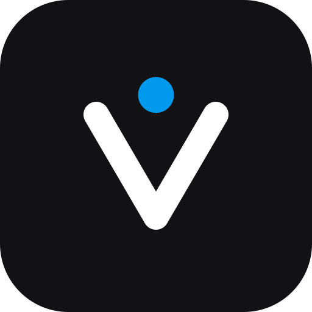
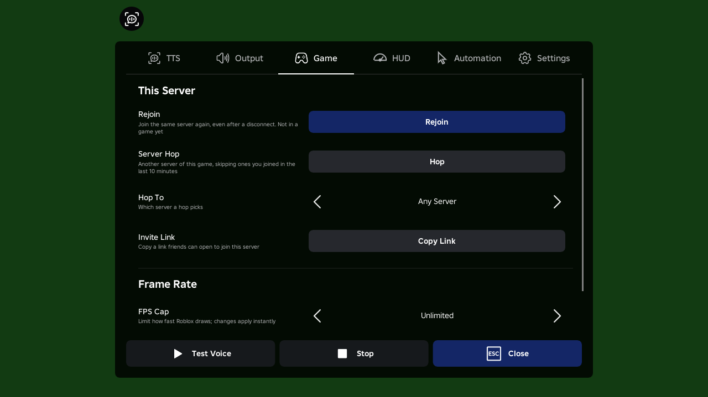

<p align="center">
  
</p>

<h1 align="center">Vox Menu</h1>

An in-game menu for Roblox on Linux through [Nightcap](https://github.com/CoderDayton/nightcap).
It's a single library, `libvox_menu.so`, loaded into an unmodified Nightcap. Formerly Vox TTS and
Nightcap AC.

<p align="center">
  
</p>

## Features

* **TTS in voice chat:** your chat messages are spoken into voice chat with Piper, eSpeak-NG or
  Animalese. Optionally play them on your speakers too, or skip sending the text (Intercept Chat).
* **Share an app's sound:** mix any app's audio (Spotify, a browser...) into your mic. No virtual
  cables.
* **HUD overlays:** FPS, ping, server location and keystrokes, styled like Roblox's top bar.
  Drag, resize and join them in the layout editor.
* **Autoclicker and macros:** clicks at the cursor or at fixed points, and recorded or
  hand-written macros. Input only goes to the Roblox window.
* **Piano player:** plays `.mid` files or a MIDI keyboard on Roblox's virtual pianos, as keys or
  MIDI Connect codes (ported from MIDI++).
* **Rejoin, server hop, invite link and FPS cap.**
* **VR:** the menu opens as a panel in the headset, and the stats can sit in view.

Press **F8** or click the top-bar button to open the menu.

## Requirements

* Nightcap on Linux, native install (`mocktail` on your PATH), with its Vulkan renderer (the
  default). Flatpak is best-effort.
* `espeak-ng`; optionally `piper` for neural voices.
* `curl` or Python 3 for server hop.
* `pactl` and `parec` for sharing app audio (PulseAudio or `pipewire-pulse`).
* `libasound` for MIDI keyboards.
* To build: a C++17 compiler, SDL3, Vulkan and OpenXR headers.

## Install

```bash
git clone https://github.com/dim-ghub/VoxMenu
cd VoxMenu
make build
make install          # into ~/.local (PREFIX=... to change)
```

`make install` then offers to patch Nightcap's launcher entry so normal launches and `roblox://`
links start with Vox Menu. `make unpatch-desktop` undoes that, `make uninstall` removes
everything.

Piper voices go in `~/.local/share/piper-voices`; `vox-menu-download-voice [name]` fetches one
(default `en_US-lessac-medium`).

## Menu controls

| Key | Action |
| --- | --- |
| Tab / Shift+Tab, ↑ / ↓ | Next / previous option |
| ← / → | Change option |
| Enter / Space | Activate |
| Q / E | Previous / next tab |
| Esc / F8 | Close |

Default hotkeys: autoclicker **F6**, play macro **F7**, record macro **F9**, automation window
**F4**, piano play/pause **F1**, back/forward 10 s **F2**/**F3**. All can be changed in the
Automation tab.

In VR, hold the left thumbstick click to open the panel, point at it and pull the trigger to
click. Keystrokes, automation and the layout editor are desktop-only.

### Macros

Saved as plain text in `~/.config/vox-menu/macros/`; see
[the format](docs/configuration.md#macro-files).

### StreamController

The piano listens on `~/.vox-menu-piano.sock` with MIDI++'s protocol (`PLAY_PAUSE`, `REWIND`,
`SKIP`, `RESTART`, `STOP`, `SPEED_UP`, `SPEED_DOWN`, `GET_TIME`, `LIST_SONGS`,
`LOAD_SONG <index>`), so the [MIDI++ plugin](https://github.com/dim-ghub/MidiPlusPlus-SD) works.

## Documentation

* [Architecture](docs/architecture.md)
* [Configuration](docs/configuration.md)
* [Development](docs/development.md)

## Credits

Rejoin, server hop and the FPS cap come from Cocktail. The ping estimate is adapted from Nightcap
(Apache-2.0).

## License

GPL-3.0-or-later. See [LICENSE](LICENSE).
